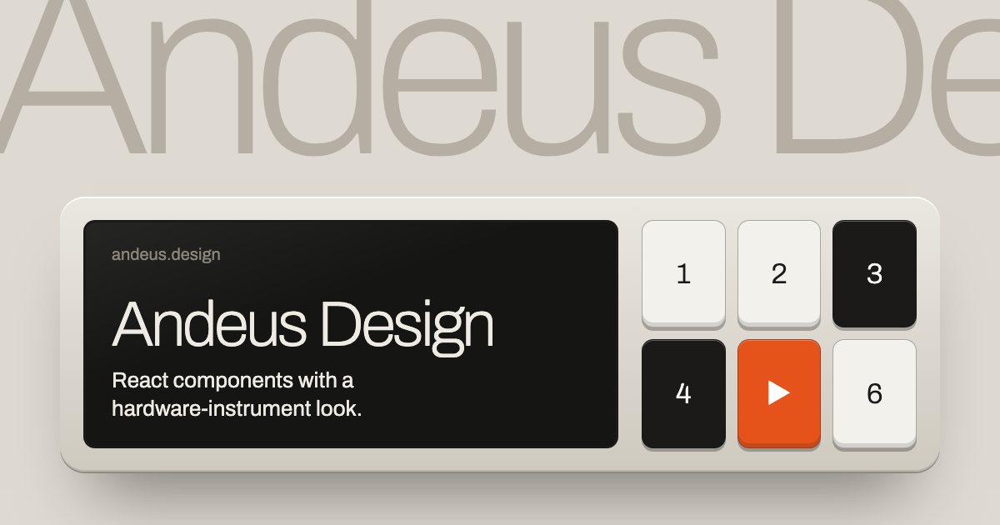

# Andeus Design

**A React component library with a hardware-instrument look.** Warm platinum casings, physical keys, black-glass screens and one signal orange, in the spirit of Dieter Rams' Braun, Teenage Engineering and the classic Mac.

[](https://andeus.design)

**[Showcase](https://andeus.design/showcase/)** · **[Docs](https://andeus.design/docs/)** · **[Components](https://andeus.design/docs/button/)**

## Features

- **28 React components:** Button, Input, Select, MultiSelect, Checkbox, Radio, Switch, Slider, Segmented, Tabs, Window, Dialog, Card, Screen, Toast, Tooltip, Badge, Tag, Chart, Metric, Block, MusicPlayer and more.
- **Design tokens as CSS custom properties.** Components read semantic aliases only, so you retheme by overriding a few variables.
- **One typeface** (Archivo, self-hosted) and a 1-bit pixel icon set on a 24px grid.
- **Readable by default:** every text token meets WCAG AA contrast on every surface.
- **No runtime dependencies** beyond React 18+.

## Install

```bash
npm install @andeus/ui
```

```jsx
import '@andeus/ui/styles.css'; // once, at the app root
import { Button, Switch } from '@andeus/ui';

export function RunControls() {
  const [live, setLive] = useState(false);
  return (
    <>
      <Switch label="Live" checked={live} onChange={setLive} />
      <Button variant="primary" disabled={!live}>Run</Button>
    </>
  );
}
```

## Theming

```css
:root {
  --accent: var(--screen-blue);
  --surface-body: var(--platinum-100);
}
```

## Repository

```
packages/ui      @andeus/ui: components, tokens, fonts
apps/site        showcase + docs (Vite, pre-rendered static site)
```

```bash
pnpm install
pnpm dev        # http://localhost:5173/showcase/
pnpm build      # library + pre-rendered site in apps/site/dist
```
